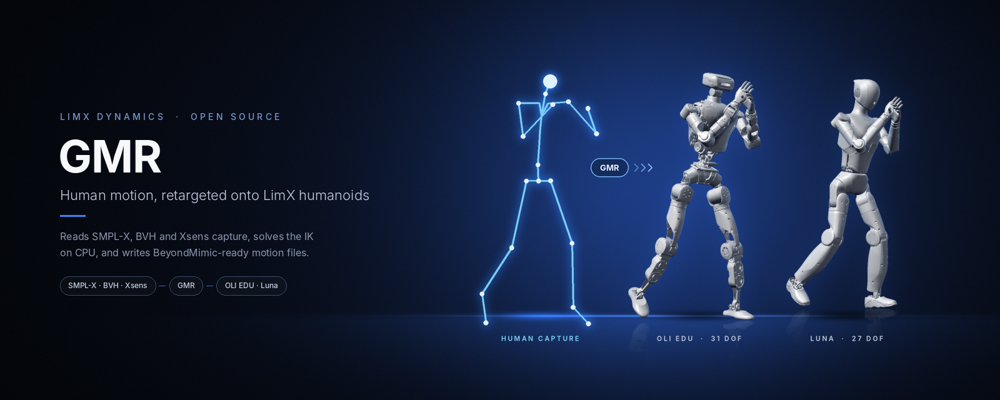
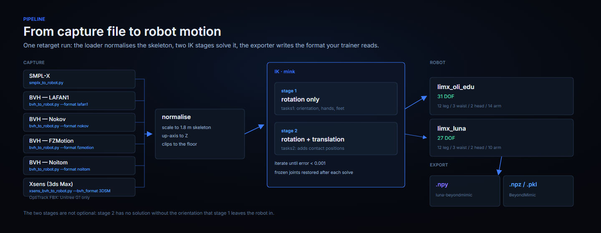
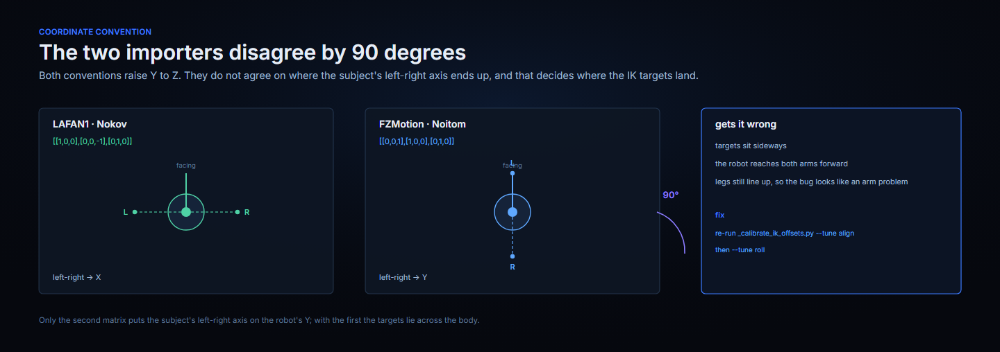
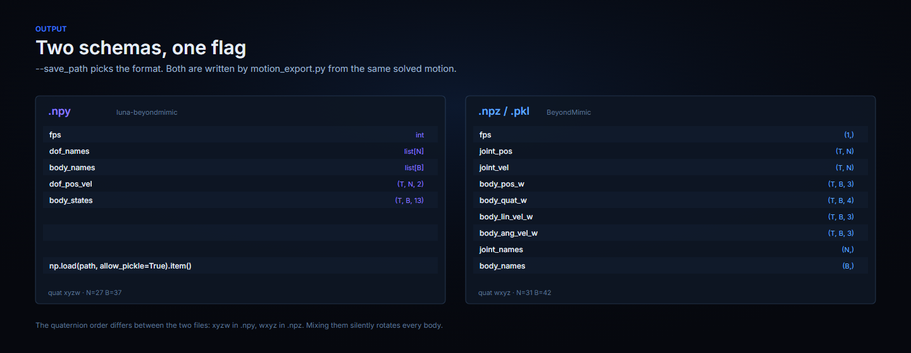

<p align="center">
  
</p>

<p align="center">
  <b>English</b> | <a href="README.zh-CN.md">中文</a>
</p>

<div align="center">

# GMR: General Motion Retargeting

</div>

<p align="center">
  <a href="https://arxiv.org/abs/2505.02833"></a>
  <a href="https://arxiv.org/abs/2510.02252"></a>
  <a href="LICENSE"></a>
  
  <a href="https://github.com/YanjieZe/GMR"></a>
</p>

LimX Dynamics' fork of [General Motion Retargeting (GMR)](https://github.com/YanjieZe/GMR). It
retargets human motion capture onto two TRON-family humanoids -- `limx_oli_edu` and `limx_luna` --
and exports the result in the formats [BeyondMimic](https://github.com/HybridRobotics/whole_body_tracking)
and [luna-beyondmimic](https://github.com/limxdynamics/luna-beyondmimic) read. This page covers the
fork; the machinery underneath is upstream's.

> **Everything that is not LimX-specific is upstream.** That documentation is kept unchanged in
> [`docs/upstream.md`](docs/upstream.md): the full robot and format support table, installation for the
> upstream repository, the SMPL-X / GVHMR / BVH / Xsens / OptiTrack pipelines, PICO streaming for
> TWIST2, the speed benchmark, the release news and the citation entries. Read it for a robot or a
> capture format this page does not cover.

<p align="center">
  
</p>

Six capture formats enter at the left. The loader normalises the skeleton and the up axis, `mink` solves two IK stages in sequence, and the exporter writes whichever schema the `--save_path` extension names.

## Quick Start (LimX Robots & BeyondMimic Motion Export)

This section covers setup, usage and output format for the two LimX robots
(`limx_oli_edu`, `limx_luna`) and the motion export aligned with
[BeyondMimic](https://github.com/HybridRobotics/whole_body_tracking) / Isaac Lab reference-motion
conventions.

### Installation

Tested on **Ubuntu 22.04 / 20.04**. GMR is not published on PyPI -- this is a source install, as
below.

```bash
conda create -n gmr python=3.10 -y
conda activate gmr
pip install -e .
conda install -c conda-forge libstdcxx-ng -y
```

**SMPL-X body models** — **not bundled** in this repo. Because the models are distributed under the non-commercial [SMPL-X license](https://smpl-x.is.tue.mpg.de/), download them yourself from the [SMPL-X website](https://smpl-x.is.tue.mpg.de/) and place `SMPLX_NEUTRAL.pkl`, `SMPLX_MALE.pkl`, and `SMPLX_FEMALE.pkl` into `assets/body_models/smplx/`. See `assets/body_models/smplx/README.md`.

Loading uses `ext="pkl"` in `general_motion_retargeting/utils/smpl.py` (not a `site_packages` patch).

**Robot assets** — neither LimX description is vendored. OLI EDU comes from the public
[`humanoid-description`](https://github.com/limxdynamics/humanoid-description) submodule; Luna
comes from the public [`luna-description`](https://github.com/limxdynamics/luna-description) submodule. Fetch both after cloning:

```bash
git submodule update --init --recursive
```

### LimX OLI EDU (`limx_oli_edu`)

| Item | Value |
| --- | --- |
| Robot key | `limx_oli_edu` |
| DoF | 31 series joints (12 leg + 3 waist + 2 head + 14 arm) |
| Base body | `base_link` |
| MuJoCo XML | `assets/humanoid-description/HU_D04_description/xml/HU_D04_01_vis.xml` (public submodule; pure serial) |
| IK configs | `{smplx,bvh_lafan1,bvh_nokov,bvh_xsens,bvh_fzmotion,bvh_noitom}_to_oli_edu.json` |

### LimX Luna / HU_L04 (`limx_luna`)

| Item | Value |
| --- | --- |
| Robot key | `limx_luna` |
| DoF | 27 series joints (12 leg + 3 waist + 2 head + 10 arm) |
| Base body | `base_link` |
| MuJoCo XML | `assets/luna-description/HU_L04_description/xml/HU_L04_01_vis.xml` (submodule) |
| IK configs | `{smplx,bvh_lafan1,bvh_nokov,bvh_xsens,bvh_fzmotion,bvh_noitom}_to_luna.json` |
| Downstream | [luna-beyondmimic](https://github.com/limxdynamics/luna-beyondmimic) motion tracking |

Each arm ends at `wrist_yaw` (5 DoF per arm, no wrist pitch/roll), so IK targets the `*_wrist_yaw_link`.

Luna targets are normalized to the configured 1.8 m reference skeleton, and the first frame's root
XY position is moved to the origin. Root Z and the subsequent XY trajectory are preserved.

**Fetch only the Luna description** (public repository):

```bash
git submodule update --init assets/luna-description
```

Already have a checkout elsewhere? Point at it instead of adding the submodule:

```bash
export LUNA_DESCRIPTION_DIR=/path/to/luna-description   # dir containing HU_L04_description/
```

### Input formats for the LimX robots

Both robots accept these capture formats. Each row is the `--robot limx_oli_edu` / `--robot limx_luna` entry point for that format.

| Format | Entry point | Notes |
| --- | --- | --- |
| SMPL-X (AMASS / OMOMO) | `scripts/smplx_to_robot.py` | also the path GVHMR video output takes |
| BVH (LAFAN1) | `scripts/bvh_to_robot.py --format lafan1` | |
| BVH (Nokov) | `scripts/bvh_to_robot.py --format nokov` | |
| BVH (FZMotion) | `scripts/bvh_to_robot.py --format fzmotion` | chest is `Chest`, not `Spine2` |
| BVH (Noitom) | `scripts/bvh_to_robot.py --format noitom` | no toe joint, so the ankle keeps its own orientation |
| BVH (Xsens, 3ds Max export) | `scripts/xsens_bvh_to_robot.py --bvh_format 3DSM` | `offsets.json` is optional; without it all channel offsets are zero |

<p align="center">
  
</p>

FZMotion and Noitom take the same loading path as agmr, which differs from LAFAN1 and Nokov
in two ways that decide where the IK targets land:

- **Yaw of the up-axis conversion.** Both conventions raise Y to Z, but LAFAN1/Nokov use
  `[[1,0,0],[0,0,-1],[0,1,0]]` while FZMotion and Noitom use `[[0,0,1],[1,0,0],[0,1,0]]`, 90 degrees
  apart. Only
  the second puts the subject's left-right axis on the robot's Y; with the first, the targets sit
  sideways and the robot reaches both arms forward.
- **Ground normalisation.** Each clip is shifted down onto the floor at load time so the root and
  feet use the same height origin.

OptiTrack FBX is supported for the Unitree G1 only.

The IK configs were calibrated with `scripts/_calibrate_ik_offsets.py`, which scores a config by how
closely the retargeted robot reproduces the human limb *directions* (lower is better; the upstream
Unitree G1 configs score 10-14 degrees on their own test data).

> [!IMPORTANT]
> **Xsens bone conventions are per capture session.** Two Xsens exports can put the same bone on
> different axes of its joint frame - in the two files here the upper arm is `-Z` in one and `+Y` in
> the other, 90 degrees apart, while the legs agree. A config calibrated on one then puts the hands
> nowhere near their targets on the other. If the arms look wrong on a new capture, re-derive the
> offsets from that file, which takes about a minute:
>
> ```bash
> python scripts/_calibrate_ik_offsets.py calibrate --robot limx_luna --src bvh_xsens \
>   --motion_file <your.bvh> --config general_motion_retargeting/ik_configs/bvh_xsens_to_luna.json \
>   --tune align          # solve rot_offset from each bone direction
> python scripts/_calibrate_ik_offsets.py calibrate --robot limx_luna --src bvh_xsens \
>   --motion_file <your.bvh> --config general_motion_retargeting/ik_configs/bvh_xsens_to_luna.json \
>   --tune roll           # then the twist about each bone, which alignment leaves free
> ```
>
> The shipped `bvh_xsens_to_{oli_edu,luna}.json` are calibrated on `data/Xsens/猫步-002.bvh`.
> `--tune chain` (limb scales from bone lengths) and `--tune ground` (root scale for foot contact)
> are the other two steps. `scripts/_recalibrate_limx.sh` preserves the fixed SMPL-X frame offsets
> and only runs `align` / `roll` for BVH sources.

### Usage

**SMPL-X → robot** (default output fps: 30):

```bash
python scripts/smplx_to_robot.py \
  --smplx_file <path_to_smplx.npz_or.pkl> \
  --robot limx_oli_edu \
  --save_path output/lx_motion.npz
```

**BVH (LAFAN1 / Nokov / FZMotion / Noitom) → robot**:

```bash
python scripts/bvh_to_robot.py \
  --bvh_file <path_to.bvh> \
  --robot limx_oli_edu \
  --format lafan1 \
  --save_path output/lx_motion.npz
```

**BVH (Xsens) → robot** — needs `--scale` to convert the file's units to metres:

```bash
python scripts/xsens_bvh_to_robot.py \
  --bvh_file assets/xsens_bvh_test/251021_04_boxing_120Hz_cm_3DsMax.bvh \
  --robot limx_luna --bvh_format 3DSM --scale 0.01 --reset_to_zero \
  --save_path output/luna_boxing.npy
```


**Luna → luna-beyondmimic `.npy`** (schema below; `--save_path` extension picks the format):

```bash
python scripts/smplx_to_robot.py \
  --smplx_file <path_to_smplx.npz_or.pkl> \
  --robot limx_luna \
  --save_path output/luna_motion.npy
```

Feed it straight into the trainer, which runs its own preparation pipeline:

```bash
# in the luna-beyondmimic checkout
python scripts/rsl_rl/train.py \
  --task=Tracking-Flat-HU-L04-Parallel-Deploy-Gravity-v0 \
  --motion_file /path/to/luna_motion.npy \
  --num_envs 4096 --headless
```

**Visualize saved motion** (`.npy`, `.npz` and legacy `.pkl` all load):

```bash
python scripts/vis_robot_motion.py \
  --robot limx_luna \
  --robot_motion_path output/luna_motion.npy
```

Add `--record_video --video_path videos/demo.mp4` to record video. Remove `--rate_limit` on retargeting scripts for maximum speed.

**Export CSV for BeyondMimic `csv_to_npz` pipeline** (root xyz + quat xyzw + joints):

```bash
python scripts/batch_gmr_pkl_to_csv.py --folder output/
# writes output/csv/*.csv
```

### Robot Motion Data Formats

<p align="center">
  
</p>

`--save_path` picks the schema by file extension, both written by `general_motion_retargeting/motion_export.py`:

| Extension | Schema | Consumer |
| --- | --- | --- |
| `.npy` | luna-beyondmimic | `prepare_motion.py` / `train.py` / `play.py` in [luna-beyondmimic](https://github.com/limxdynamics/luna-beyondmimic) |
| `.npz`, `.pkl` | BeyondMimic key layout | `scripts/vis_robot_motion.py`, `scripts/batch_gmr_pkl_to_csv.py` |

Body positions and orientations are the MuJoCo body frame (`xpos` / `xquat`), and body velocities are taken at that same frame origin (`mj_objectVelocity` on `mjOBJ_XBODY`), so the velocities are the derivative of the exported positions.

#### luna-beyondmimic `.npy`

A pickled dict, loaded with `np.load(path, allow_pickle=True).item()`:

| Key | Shape | Description |
| --- | --- | --- |
| `fps` | `int` | Frame rate |
| `dof_names` | list of `N` | Joint names |
| `body_names` | list of `B` | Body names (world body excluded) |
| `dof_pos_vel` | `(T, N, 2)` | Joint position [rad] and velocity [rad/s] |
| `body_states` | `(T, B, 13)` | `pos(3)` + `quat_xyzw(4)` + `lin_vel(3)` + `ang_vel(3)`, world frame |

Quaternions are **xyzw** here, matching what `npy_to_npz.py` expects. For `limx_luna`: `N = 27`, `B = 37`. The consumer reorders both axes by name, so only the names have to agree — joint names exactly, body names as a subset of its articulation (the 14 linkage/helper bodies it adds are zero-filled).

#### BeyondMimic `.npz` / `.pkl`

| Key | Shape | Description |
| --- | --- | --- |
| `fps` | `(1,)` | Frame rate, e.g. `[30.]` |
| `joint_pos` | `(T, N)` | Actuated joint angles [rad] (**excludes** floating base) |
| `joint_vel` | `(T, N)` | Joint velocities [rad/s] |
| `body_pos_w` | `(T, B, 3)` | Body positions in world frame [m] |
| `body_quat_w` | `(T, B, 4)` | Body orientations in world frame, **wxyz** |
| `body_lin_vel_w` | `(T, B, 3)` | Body linear velocities [m/s] |
| `body_ang_vel_w` | `(T, B, 3)` | Body angular velocities [rad/s] |
| `joint_names` | `(N,)` | Joint names, same order as `joint_pos` columns |
| `body_names` | `(B,)` | Body names (world body excluded), same order as body tensors |

For `limx_oli_edu`: `N = 31`, `B = 42` (example after retargeting).

**Load in Python:**

```python
import numpy as np
motion = dict(np.load("output/lx_motion.npz", allow_pickle=True))
print(motion["joint_pos"].shape, motion["fps"], list(motion["joint_names"][:3]))
```

**Joint column order** follows the MuJoCo model, i.e. left leg → right leg → waist → head → left arm → right arm: 6/6/3/2/7/7 for `limx_oli_edu` (arm ends at `wrist_roll`), 6/6/3/2/5/5 for `limx_luna` (arm ends at `wrist_yaw`).

**Legacy format** (older runs): `root_pos`, `root_rot` (xyzw), `dof_pos` — still readable by `load_robot_motion()` / visualization helpers.

## License

MIT, same as upstream: [`LICENSE`](LICENSE) carries both copyright lines (Yanjie Ze, 2025; LimX
Dynamics, 2026). Third-party robot assets vendored under `assets/` and their licences are listed in
[`THIRD_PARTY_NOTICES`](THIRD_PARTY_NOTICES).