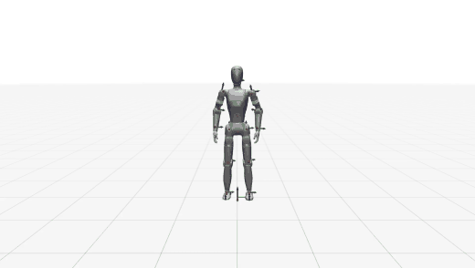

<p align="center">
  <a href="README.md">English</a> | <b>中文</b>
</p>

<p align="center">
  
</p>

# GMR: General Motion Retargeting

<p align="center">
  <a href="https://arxiv.org/abs/2505.02833"></a>
  <a href="https://arxiv.org/abs/2510.02252"></a>
  <a href="LICENSE"></a>
  
  <a href="https://github.com/YanjieZe/GMR"></a>
</p>

逐际动力（LimX Dynamics）对 [General Motion Retargeting (GMR)](https://github.com/YanjieZe/GMR) 的 fork：
把人体动捕数据重定向到两款 TRON 系列人形（`limx_oli_edu` 与 `limx_luna`），并按
[BeyondMimic](https://github.com/HybridRobotics/whole_body_tracking) 与
[luna-beyondmimic](https://github.com/limxdynamics/luna-beyondmimic) 能直接读取的格式导出。
本页只讲 fork 的部分，底层实现与上游一致。

> **与 LimX 无关的内容都在上游文档里。** [`docs/upstream.zh-CN.md`](docs/upstream.zh-CN.md) 是上游 README 的原样副本：
> 完整的机器人与数据格式支持表、上游仓库的安装方式、SMPL-X / GVHMR / BVH / Xsens / OptiTrack 各条链路、
> TWIST2 的 PICO 实时流、速度基准、版本新闻与引用条目。本页没覆盖的机器人或采集格式去那里找。

## 快速上手（LimX 机器人 & BeyondMimic 动作导出）

本节记录本 fork 的安装、使用与输出格式：两款 LimX 机器人（`limx_oli_edu`、`limx_luna`），
以及对齐 [BeyondMimic](https://github.com/HybridRobotics/whole_body_tracking) / Isaac Lab 参考动作约定的动作导出。

### 安装

已在 **Ubuntu 22.04 / 20.04** 上测试通过。

```bash
conda create -n gmr python=3.10 -y
conda activate gmr
pip install -e .
conda install -c conda-forge libstdcxx-ng -y
```

**SMPL-X 人体模型** —— **不随仓库分发**。由于这些模型受非商用的 [SMPL-X license](https://smpl-x.is.tue.mpg.de/) 约束，请自行从 [SMPL-X 官网](https://smpl-x.is.tue.mpg.de/) 下载，并将 `SMPLX_NEUTRAL.pkl`、`SMPLX_MALE.pkl`、`SMPLX_FEMALE.pkl` 放入 `assets/body_models/smplx/`。详见 `assets/body_models/smplx/README.md`。

加载是通过 `general_motion_retargeting/utils/smpl.py` 中的 `ext="pkl"` 完成的（无需改动 `site_packages`）。

**机器人资产** —— 两款 LimX 的 description 均未随仓库内置。OLI EDU 来自公开的 [`humanoid-description`](https://github.com/limxdynamics/humanoid-description) 子模块；Luna 来自公开的 [`luna-description`](https://github.com/limxdynamics/luna-description) 子模块。克隆后请拉取两个子模块：

```bash
git submodule update --init --recursive
```

### LimX OLI EDU（`limx_oli_edu`）

| 项目 | 值 |
| --- | --- |
| 机器人 key | `limx_oli_edu` |
| DoF | 31 个串联关节（12 腿 + 3 腰 + 2 头 + 14 臂） |
| Base body | `base_link` |
| MuJoCo XML | `assets/humanoid-description/HU_D04_description/xml/HU_D04_01_vis.xml`（公开子模块；纯串联） |
| IK 配置 | `{smplx,bvh_lafan1,bvh_nokov,bvh_xsens,bvh_fzmotion,bvh_noitom}_to_oli_edu.json` |

### LimX Luna / HU_L04（`limx_luna`）

| 项目 | 值 |
| --- | --- |
| 机器人 key | `limx_luna` |
| DoF | 27 个串联关节（12 腿 + 3 腰 + 2 头 + 10 臂） |
| Base body | `base_link` |
| MuJoCo XML | `assets/luna-description/HU_L04_description/xml/HU_L04_01_vis.xml`（子模块） |
| IK 配置 | `{smplx,bvh_lafan1,bvh_nokov,bvh_xsens,bvh_fzmotion,bvh_noitom}_to_luna.json` |
| 下游 | [luna-beyondmimic](https://github.com/limxdynamics/luna-beyondmimic) 动作跟踪 |

每条手臂末端为 `wrist_yaw`（每条手臂 5 DoF，无 wrist pitch/roll），因此 IK 目标指向 `*_wrist_yaw_link`。

Luna 目标已归一化到配置的 1.8 m 参考骨架，且首帧的根节点 XY 位置被移到原点。根节点 Z 及后续 XY 轨迹保持不变。

**仅拉取 Luna description**（公开仓库）：

```bash
git submodule update --init assets/luna-description
```

已在别处有检出？直接指向它而无需添加子模块：

```bash
export LUNA_DESCRIPTION_DIR=/path/to/luna-description   # 包含 HU_L04_description/ 的目录
```

### LimX 机器人的输入格式

两款机器人都支持以下采集格式。每一行对应 `--robot limx_oli_edu` / `--robot limx_luna` 的该格式入口。

| 格式 | 入口 | 备注 |
| --- | --- | --- |
| SMPL-X（AMASS / OMOMO） | `scripts/smplx_to_robot.py` | GVHMR 视频输出的处理路径也是它 |
| BVH（LAFAN1） | `scripts/bvh_to_robot.py --format lafan1` | |
| BVH（Nokov） | `scripts/bvh_to_robot.py --format nokov` | |
| BVH（FZMotion） | `scripts/bvh_to_robot.py --format fzmotion` | 胸部节点是 `Chest`，不是 `Spine2` |
| BVH（Noitom） | `scripts/bvh_to_robot.py --format noitom` | 无脚趾关节，脚踝保持自身朝向 |
| BVH（Xsens，3ds Max 导出） | `scripts/xsens_bvh_to_robot.py --bvh_format 3DSM` | `offsets.json` 可选；缺省时所有通道 offset 为零 |

FZMotion 与 Noitom 的加载方式与 agmr 一致，与 LAFAN1 和 Nokov 有两处差异，决定了 IK 目标落点：

- **向上轴转换的偏航角。** 两种约定都把 Y 抬升为 Z，但 LAFAN1/Nokov 使用 `[[1,0,0],[0,0,-1],[0,1,0]]`，而 FZMotion 与 Noitom 使用 `[[0,0,1],[1,0,0],[0,1,0]]`，相差 90 度。只有后者把人的左右轴放在机器人的 Y 轴上；用前者时目标会侧放，机器人双臂前伸。
- **地面归一化。** 每段 clip 在加载时下移到地面，使根节点与脚使用同一高度原点。

OptiTrack FBX 仅支持 Unitree G1。

IK 配置使用 `scripts/_calibrate_ik_offsets.py` 标定，它通过重定向后的机器人复现人体肢体*方向*的接近程度来给配置打分（越小越好；上游 Unitree G1 配置在其自身测试数据上得分为 10–14 度）。

> [!IMPORTANT]
> **Xsens 骨骼约定随采集会话而异。** 两份 Xsens 导出可能把同一根骨骼放在其关节坐标系的不同轴上——这里的两个文件中上臂在一个里是 `-Z`、在另一个里是 `+Y`，相差 90 度，而腿部一致。基于其中一个标定的配置会让双手完全对不上另一个目标。若新采集的臂部看起来不对，请根据该文件重新推导 offset，约需一分钟：
>
> ```bash
> python scripts/_calibrate_ik_offsets.py calibrate --robot limx_luna --src bvh_xsens \
>   --motion_file <your.bvh> --config general_motion_retargeting/ik_configs/bvh_xsens_to_luna.json \
>   --tune align          # 由每根骨骼方向求解 rot_offset
> python scripts/_calibrate_ik_offsets.py calibrate --robot limx_luna --src bvh_xsens \
>   --motion_file <your.bvh> --config general_motion_retargeting/ik_configs/bvh_xsens_to_luna.json \
>   --tune roll           # 再求解每根骨骼的扭转，align 未覆盖的自由度
> ```
>
> 仓库内的 `bvh_xsens_to_{oli_edu,luna}.json` 基于 `data/Xsens/猫步-002.bvh` 标定。
> 另两个步骤是 `--tune chain`（由骨骼长度求肢体缩放）和 `--tune ground`（由脚接触求根缩放）。`scripts/_recalibrate_limx.sh` 保留固定的 SMPL-X 帧 offset，仅对 BVH 来源执行 `align` / `roll`。

### 使用

**SMPL-X → 机器人**（默认输出帧率 30）：

```bash
python scripts/smplx_to_robot.py \
  --smplx_file <path_to_smplx.npz_or.pkl> \
  --robot limx_oli_edu \
  --save_path output/lx_motion.npz
```

**BVH（LAFAN1 / Nokov / FZMotion / Noitom）→ 机器人**：

```bash
python scripts/bvh_to_robot.py \
  --bvh_file <path_to.bvh> \
  --robot limx_oli_edu \
  --format lafan1 \
  --save_path output/lx_motion.npz
```

**BVH（Xsens）→ 机器人** —— 需要 `--scale` 把文件单位换算成米：

```bash
python scripts/xsens_bvh_to_robot.py \
  --bvh_file assets/xsens_bvh_test/251021_04_boxing_120Hz_cm_3DsMax.bvh \
  --robot limx_luna --bvh_format 3DSM --scale 0.01 --reset_to_zero \
  --save_path output/luna_boxing.npy
```


**Luna → luna-beyondmimic `.npy`**（schema 见下；`--save_path` 的扩展名决定格式）：

```bash
python scripts/smplx_to_robot.py \
  --smplx_file <path_to_smplx.npz_or.pkl> \
  --robot limx_luna \
  --save_path output/luna_motion.npy
```

直接喂给训练器，它会运行自己的准备流水线：

```bash
# 在 luna-beyondmimic 检出目录中
python scripts/rsl_rl/train.py \
  --task=Tracking-Flat-HU-L04-Parallel-Deploy-Gravity-v0 \
  --motion_file /path/to/luna_motion.npy \
  --num_envs 4096 --headless
```

**可视化已保存的动作**（`.npy`、`.npz` 与旧版 `.pkl` 均可加载）：

```bash
python scripts/vis_robot_motion.py \
  --robot limx_luna \
  --robot_motion_path output/luna_motion.npy
```

加 `--record_video --video_path videos/demo.mp4` 可录制视频。想达到最大速度，可去掉重定向脚本上的 `--rate_limit`。

**导出 BeyondMimic `csv_to_npz` 流水线所需的 CSV**（根 xyz + 四元数 xyzw + 关节）：

```bash
python scripts/batch_gmr_pkl_to_csv.py --folder output/
# 输出到 output/csv/*.csv
```

### 机器人动作数据格式

`--save_path` 按文件扩展名选择 schema，两者都由 `general_motion_retargeting/motion_export.py` 写入：

| 扩展名 | Schema | 消费方 |
| --- | --- | --- |
| `.npy` | luna-beyondmimic | [luna-beyondmimic](https://github.com/limxdynamics/luna-beyondmimic) 中的 `prepare_motion.py` / `train.py` / `play.py` |
| `.npz`, `.pkl` | BeyondMimic key 布局 | `scripts/vis_robot_motion.py`、`scripts/batch_gmr_pkl_to_csv.py` |

身体位置与朝向为 MuJoCo body 坐标系（`xpos` / `xquat`），身体速度取自同一坐标系原点（对 `mjOBJ_XBODY` 的 `mj_objectVelocity`），因此速度是导出位置的导数。

#### luna-beyondmimic `.npy`

一个 pickled dict，用 `np.load(path, allow_pickle=True).item()` 加载：

| Key | 形状 | 描述 |
| --- | --- | --- |
| `fps` | `int` | 帧率 |
| `dof_names` | 长度为 `N` 的 list | 关节名 |
| `body_names` | 长度为 `B` 的 list | 刚体名（不含 world body） |
| `dof_pos_vel` | `(T, N, 2)` | 关节位置 [rad] 与速度 [rad/s] |
| `body_states` | `(T, B, 13)` | `pos(3)` + `quat_xyzw(4)` + `lin_vel(3)` + `ang_vel(3)`，世界系 |

这里的四元数为 **xyzw** 顺序，与 `npy_to_npz.py` 的期望一致。对 `limx_luna`：`N = 27`、`B = 37`。消费方按名称重排两个轴，因此只需名称一致——关节名需完全一致，body 名是其关节体的子集（它追加的 14 个连杆/辅助 body 会被零填充）。

#### BeyondMimic `.npz` / `.pkl`

| Key | 形状 | 描述 |
| --- | --- | --- |
| `fps` | `(1,)` | 帧率，如 `[30.]` |
| `joint_pos` | `(T, N)` | 驱动关节角度 [rad]（**不含**浮动基座） |
| `joint_vel` | `(T, N)` | 关节速度 [rad/s] |
| `body_pos_w` | `(T, B, 3)` | 世界系身体位置 [m] |
| `body_quat_w` | `(T, B, 4)` | 世界系身体朝向，**wxyz** |
| `body_lin_vel_w` | `(T, B, 3)` | 身体线速度 [m/s] |
| `body_ang_vel_w` | `(T, B, 3)` | 身体角速度 [rad/s] |
| `joint_names` | `(N,)` | 关节名，与 `joint_pos` 列同序 |
| `body_names` | `(B,)` | 身体名（不含 world body），与身体张量同序 |

对 `limx_oli_edu`：`N = 31`、`B = 42`（重定向后的示例）。

**在 Python 中加载：**

```python
import numpy as np
motion = dict(np.load("output/lx_motion.npz", allow_pickle=True))
print(motion["joint_pos"].shape, motion["fps"], list(motion["joint_names"][:3]))
```

**关节列顺序** 遵循 MuJoCo 模型，即左腿 → 右腿 → 腰 → 头 → 左臂 → 右臂：`limx_oli_edu` 为 6/6/3/2/7/7（手臂止于 `wrist_roll`），`limx_luna` 为 6/6/3/2/5/5（手臂止于 `wrist_yaw`）。

**旧格式**（更早的运行）：`root_pos`、`root_rot`（xyzw）、`dof_pos` —— 仍可被 `load_robot_motion()` / 可视化辅助函数读取。

## 许可证

与上游同为 MIT：[`LICENSE`](LICENSE) 里同时有两条版权行（Yanjie Ze，2025；LimX Dynamics，2026）。
`assets/` 下随仓库分发的第三方机器人模型及其许可见 [`THIRD_PARTY_NOTICES`](THIRD_PARTY_NOTICES)。